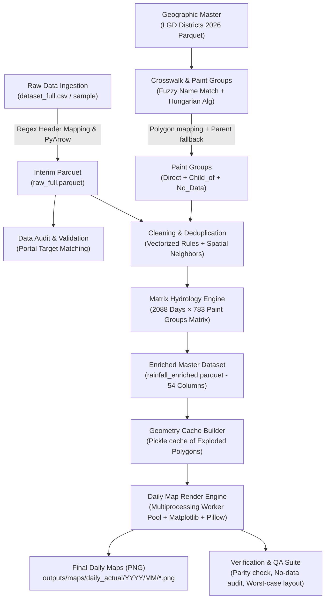

# 🌧️ Complete Project Architecture & End-to-End Pipeline Guide
## *India District-Wise Daily Rainfall Mapping & Hydrological Analytics System (NDAP / IMD)*

---

## 🧭 1. Executive Summary & Project Goal (Non-Technical Overview)

### What is this project?
This project is an **end-to-end data processing, quality assurance, hydrological modeling, and automated cartography (map generation) pipeline**. It takes messy, real-world meteorological rainfall data from over **700+ Indian districts across 2021–2026** (from NDAP/IMD) and transforms it into **accurate daily rainfall maps**, hydrological indicators (drought/wet spell tracking, monsoon progress), and verified statistical summaries.

### Why was it built?
1. **Raw Data Imperfections:** Raw government weather datasets contain naming inconsistencies, historical district splits/mergers, duplicate reports, extreme unverified values (e.g., sensor anomalies), and missing dates.
2. **Automated Publishing:** Generating thousands of high-resolution, publication-grade daily maps manually is impossible. This pipeline renders **~1,800 daily choropleth maps** automatically in minutes using multi-processing.
3. **Hydrological Intelligence:** Beyond simple rainfall measurements, it computes strict cumulative monsoon metrics, rolling rain sums (3-day, 7-day, 30-day), and dry/wet spell streaks.

---

## 🗺️ 2. High-Level End-to-End Flow Diagram

The complete journey of data from raw CSV files to finished visual maps:



---

## 📂 3. Repository Directory Structure (Folder by Folder)

Below is a breakdown of every folder in the repository and why it exists:

```
d:\final year project\
├── config/                     # Configuration files and manual adjustment rules
│   ├── config.yaml             # Master system settings (paths, thresholds, map styles)
│   ├── name_aliases.csv        # Known spelling variations between dataset & maps
│   └── manual_overrides.csv    # Manual fixes for swapped or ambiguous districts
│
├── data/                       # Data storage at different lifecycle stages
│   ├── raw/                    # Untouched raw CSV datasets from portal
│   ├── interim/                # Standardized Parquet files after ingestion
│   ├── geo/                    # Shapefiles, GeoJSONs, and LGD district boundaries
│   └── processed/              # Cleaned, enriched datasets, crosswalks, and matrices
│
├── docs/                       # Architectural documentation and code layout guides
│   └── CODE_LAYOUT.md          # Reference table for module responsibilities
│
├── logs/                       # Execution manifests, memory logs, and error traces
│
├── outputs/                    # All deliverables generated by the pipeline
│   ├── maps/                   # Generated PNG maps (daily_actual, trial, reference)
│   ├── tables/                 # CSV reports (duplicates resolved, crosswalk, stats)
│   ├── reports/                # Markdown audit summaries and data dictionaries
│   └── checkpoints/            # Intermediate pipeline states for fast resumes
│
├── scripts/                    # Automation scripts for rendering, QA, and pipeline
│   ├── pipeline/               # Pipeline resume and execution scripts
│   ├── render/                 # Multiprocessing map renderers and cache builders
│   └── verify/                 # Quality assurance, parity checks, contact sheets
│
├── src/rainfall/               # Core Python library containing all business logic
└── tests/                      # Automated test suite (Pytest)
```

---

## ⚙️ 4. Step-by-Step Data Pipeline: From Input to Final Output

### Stage 1: Ingestion & Standardization (`src/rainfall/io.py`)
* **Input:** `data/raw/dataset_full.csv` (or `dataset_sample_5k.csv`) containing ~1.32 million rows with 25 columns.
* **Problem:** Raw CSVs are slow to parse, take massive RAM, and have messy column headers (e.g., `"Monthly Acutual"` typos).
* **What the Code Does:**
  1. Reads header line and matches column names using regular expressions ([io.py](file:///d:/final%20year%20project/src/rainfall/io.py#L21-L47)).
  2. Converts strings to standardized types: categories for text, dates to `datetime64`, and numbers to `float32` to save memory.
  3. Writes out compressed `data/interim/raw_full.parquet` using the high-performance `pyarrow` engine.
* **Output:** `data/interim/raw_full.parquet` (Loads in seconds instead of minutes).

---

### Stage 2: Data Audit & Portal Reconciliation (`src/rainfall/audit.py`)
* **Input:** `data/interim/raw_full.parquet` and threshold expectations from [config.yaml](file:///d:/final%20year%20project/config/config.yaml#L19-L40).
* **What the Code Does:**
  1. Verifies column distributions: min, max, mean, median, null counts.
  2. Checks calendar coverage: identifies that the dataset covers **1,800 active dates** between 2021-01-01 and 2026-09-19 (with 288 calendar gap days).
  3. Recomputes percentage departures from normal rainfall:
     $$\text{Departure \%} = \frac{\text{Actual} - \text{Normal}}{\text{Normal}} \times 100$$
     *(Guarded by a 2.5 mm threshold to prevent division by near-zero numbers).*
* **Output:** `outputs/reports/data_audit_full.md` confirming data fidelity.

---

### Stage 3: Geographic Boundary Matching & Crosswalk (`crosswalk.py` & `paint_groups.py`)
* **Input:**
  1. Indian Survey of India (SOI) boundary.
  2. Local Government Directory (LGD 2026) District Boundary polygon file (785 polygons).
  3. Dataset district list (735 unique state-district combinations).
* **Problem:** Government boundary names and dataset names often differ (e.g., `"Kanchipuram"` vs `"Kancheepuram"`, new districts carved out of older ones).
* **What the Code Does:**
  1. **Pass 0 (Manual Overrides):** Loads [manual_overrides.csv](file:///d:/final%20year%20project/config/manual_overrides.csv) for known boundary swaps (e.g. Bengaluru Urban vs Rural).
  2. **Pass 1 & 2 (Exact & Normalized Matching):** Strips spaces, standardizes casing, handles common aliases.
  3. **Pass 3 (Fuzzy String Matching):** Uses RapidFuzz token matching score ($\ge 92\%$).
  4. **Pass 4 (Hungarian Algorithm):** Uses global optimization via `scipy.optimize.linear_sum_assignment` to pair up remaining districts inside each state.
  5. **Orphan / Child Polygon Resolution (`paint_groups.py`):** For newly carved districts present on the modern map but not in the historical weather dataset, the system performs **spatial intersection**: it finds which parent IMD boundary contains $\ge 50\%$ of the child district polygon and assigns the child the parent's weather data (tagged as `child_of_<Parent>`).
* **Output:** `data/processed/district_crosswalk.csv` and `data/processed/paint_group_polygons.csv`.

---

### Stage 4: Cleaning & Vectorized Deduplication (`m3_clean.py`, `dedupe.py`, `extremes.py`)
* **Input:** Raw dataset + Crosswalk mappings.
* **What the Code Does:**
  1. **Deduplication:** The raw data has **42,258 duplicate groups** (same district and date reported more than once). The pipeline solves this via:
     - Retaining non-null entries.
     - Averaging near-identical reports ($<0.5\text{ mm}$ difference).
     - Using Queen spatial neighbors (checking neighboring districts) to pick the most plausible reading.
     - Unresolvable wild conflicts are set to `NaN` and flagged in QC logs.
  2. **Anomaly Cleaning:** Clamps negative rainfall to `NaN` (flags `qc_negative_fixed`), detects extreme single-day rainfall ($>500\text{ mm}$), and cross-checks spatial isolation.
* **Output:** `data/processed/checkpoints/deduped.parquet` (reduced from 1,320,770 to 1,274,184 clean rows).

---

### Stage 5: Hydrology Matrix Calculations (`hydrology_matrix.py`)
* **Input:** Clean daily rainfall numbers for each paint group across all dates.
* **Why Matrix Math?** Iterating 1.27M rows with Pandas `rolling()` is very slow and causes memory crashes on Windows. Instead, this system converts the data into a dense 2D NumPy array:
  $$\text{Shape: } [783 \text{ Paint Groups} \times 2088 \text{ Calendar Days}]$$
* **What it Computes in Seconds:**
  - **Rolling Rain:** Strict 3-day, 7-day, and 30-day cumulative sums.
  - **Monsoon Cumulative:** Cumulative rainfall starting June 1st of each year.
  - **Dry & Wet Spells:** Continuous streak of rainy days ($\ge 2.5\text{ mm}$) and dry days ($<2.5\text{ mm}$).
* **Output:** Merged into `data/processed/rainfall_enriched.parquet` (54 enriched columns).

---

### Stage 6: High-Speed Map Rendering Engine (`render_daily.py`, `render_pool.py`)
* **Input:** `rainfall_enriched.parquet` and the pre-computed geometry cache (`geometry.pkl`).
* **How It Achieves High Speed & Beauty:**
  1. **Pre-Exploded PolyCollection:** Polygons are loaded once as Matplotlib `PolyCollection` paths. The worker never parses heavy GIS files inside the loop.
  2. **Official IMD Categorical Palette:**
     - 🟨 **No Rain:** $0.0\text{ mm}$
     - 🟩 **Very Light:** $0.1 - 2.4\text{ mm}$
     - 🟢 **Light:** $2.5 - 15.5\text{ mm}$
     - 🟦 **Moderate:** $15.6 - 64.4\text{ mm}$
     - 🟧 **Heavy:** $64.5 - 115.5\text{ mm}$
     - 🟥 **Very Heavy:** $115.6 - 204.4\text{ mm}$
     - 🟪 **Extremely Heavy:** $\ge 204.5\text{ mm}$
     - ⬛ **No Data:** Grey with diagonal hatching (`///`).
  3. **Multi-Core Worker Pool:** Spawns worker processes scaled to available system RAM (~0.59 GB per worker) to render all ~1,800 days in parallel.
  4. **Pillow Direct Compression:** Saves images directly with optimized Zlib compression.
* **Output:** `outputs/maps/daily_actual/YYYY/MM/rainfall_actual_YYYY-MM-DD.png`.

---

## 🔍 5. Complete File-by-File Explanation (Core Codebase)

Below is an explanation of every file in `src/rainfall/`:

| File Name | Purpose & Role | Key Functions / Classes |
| :--- | :--- | :--- |
| [cli.py](file:///d:/final%20year%20project/src/rainfall/cli.py) | **Command-Line Interface:** Provides user commands (`ingest`, `audit`, `clean`, `render`, `gates`) using the Typer framework. Sets thread limits to prevent out-of-memory errors. | `app()`, `cmd_ingest()`, `cmd_clean()`, `cmd_render()` |
| [config.py](file:///d:/final%20year%20project/src/rainfall/config.py) | **Configuration Manager:** Loads `config.yaml` and resolves absolute paths across any operating system. | `load_config()`, `resolve_path()`, `project_root()` |
| [io.py](file:///d:/final%20year%20project/src/rainfall/io.py) | **Input/Output Engine:** Parses raw CSVs, maps regex headers, types columns, and writes/reads fast Parquet files. | `ingest_raw_csv()`, `map_raw_columns()`, `write_parquet()` |
| [schema.py](file:///d:/final%20year%20project/src/rainfall/schema.py) | **Data Schema Definition:** Defines exact expected column types, categorical levels, and data validation bounds. | `RAW_SCHEMA`, `ENRICHED_COLUMNS` |
| [audit.py](file:///d:/final%20year%20project/src/rainfall/audit.py) | **Data Quality Auditor:** Calculates baseline statistics and compares them against IMD portal targets to verify dataset integrity. | `run_audit()`, `recompute_departures()`, `check_coverage()` |
| [names.py](file:///d:/final%20year%20project/src/rainfall/names.py) | **String Normalizer:** Cleans district/state strings (lowercasing, removing punctuation, applying standard aliases). | `normalize_district()`, `normalize_state()`, `district_key()` |
| [geo.py](file:///d:/final%20year%20project/src/rainfall/geo.py) | **GIS & Geometry Core:** Loads LGD district boundaries, builds SOI external outlines, and transforms Coordinate Reference Systems (CRS EPSG:4326 to Equal Area EPSG:7755). | `load_districts()`, `load_india_outline()`, `run_geo_pipeline()` |
| [crosswalk.py](file:///d:/final%20year%20project/src/rainfall/crosswalk.py) | **Name-to-Polygon Linker:** Matches dataset district names to geographic polygons using exact, fuzzy, and Hungarian matching algorithms. | `match_dataset_to_polygons()`, `build_crosswalk_from_gpkg()` |
| [paint_groups.py](file:///d:/final%20year%20project/src/rainfall/paint_groups.py) | **Paint Group Resolver:** Groups polygons so parent-child split districts share weather values and orphan polygons are given fallback data. | `build_paint_groups()`, `assign_orphan_polygons()` |
| [dedupe.py](file:///d:/final%20year%20project/src/rainfall/dedupe.py) | **Duplicate Handler:** Resolves duplicate reports for the same district and date using non-null selection, mean averaging, or spatial neighbor median comparisons. | `vectorized_dedupe()`, `resolve_duplicate_group()` |
| [extremes.py](file:///d:/final%20year%20project/src/rainfall/extremes.py) | **Extreme Weather QC:** Inspects rainfall $>500\text{ mm}$ against surrounding districts to differentiate genuine extreme storms from gauge errors. | `build_extreme_review()`, `apply_map_column()` |
| [hydrology_matrix.py](file:///d:/final%20year%20project/src/rainfall/hydrology_matrix.py) | **Fast Hydrology Matrix:** Uses 2D NumPy arrays to rapidly compute multi-day rolling rain sums, monsoon accumulations, and dry/wet spells. | `build_paint_group_matrix()`, `rolling_sum_nan_strict()`, `monsoon_cumulative()` |
| [classes.py](file:///d:/final%20year%20project/src/rainfall/classes.py) | **Classification Rules:** Implements official IMD rainfall intensity bins and departure percentage categories (Excess, Normal, Deficient, etc.). | `daily_intensity_class()`, `departure_category()`, `guarded_departure()` |
| [palette_lab.py](file:///d:/final%20year%20project/src/rainfall/palette_lab.py) | **Color Palette Definitions:** Defines verified hex codes for each rainfall category, no-data hatches, and map background colors. | `PALETTE_HEX`, `NODATA_FACE`, `OUTSIDE_FILL` |
| [render_geom.py](file:///d:/final%20year%20project/src/rainfall/render_geom.py) | **Render Geometry Struct:** Pre-loads and structures exploded polygon coordinates and bounding boxes for instant drawing. | `RenderGeometry`, `load_render_geometry()` |
| [render_daily.py](file:///d:/final%20year%20project/src/rainfall/render_daily.py) | **Map Drawing Engine:** Builds the Matplotlib figure layout (main map, title, dynamic stats cards, inset boxes, and legend). | `DailyMapRenderer`, `draw_date()`, `save()` |
| [render_pool.py](file:///d:/final%20year%20project/src/rainfall/render_pool.py) | **Multi-Core Worker Pool:** Coordinates parallel processing across CPU cores while monitoring RAM consumption. | `worker_count()`, `render_all_parallel()` |
| [m3_clean.py](file:///d:/final%20year%20project/src/rainfall/m3_clean.py) | **Master Cleaning Coordinator:** Coordinates deduplication, crosswalk merging, matrix enrichment, and final output writing. | `run_m3_fresh()`, `enrich_dataframe()` |
| [m3_finalize.py](file:///d:/final%20year%20project/src/rainfall/m3_finalize.py) | **Final Aggregates:** Produces state-level and national-level summaries, monthly totals, and auto-generates the data dictionary. | `run_finalize()`, `generate_data_dictionary()` |

---

## ❓ 6. Frequently Asked Questions & Viva / Defense Preparation

### Q1: Why not just plot data directly using `geopandas.plot()`?
> **Answer:** `geopandas.plot()` creates and destroys matplotlib geometry objects on every iteration. For 1,800 days $\times$ 785 polygons, this is extremely slow (~10–15 seconds per map). Our custom `DailyMapRenderer` with `PolyCollection` loads the geometry into memory once and only updates the color array per frame, taking **under 0.3 seconds per map**.

### Q2: What happens when a new district was formed after the weather dataset started?
> **Answer:** This is handled by our **Paint Groups (`paint_groups.py`)**. Using spatial intersection with historical IMD boundaries, child polygons inherit their parent district's reported rainfall, and a clear footnote is automatically placed on the map (*"Districts created after IMD's reference map show their parent district's value"*).

### Q3: Why is Parquet used instead of CSV for intermediate and final data?
> **Answer:** Parquet is a columnar binary format with Snappy/Zstd compression. It reduces disk space by $>80\%$, retains strict data types (timestamps, floats, categories), and allows selective column reads with predicate pushdown (loading only the columns needed for map rendering in milliseconds).

---

## 🚀 7. How to Run the Project (Quick Commands)

```powershell
# 1. Ingest Raw CSV to Parquet
python -m rainfall.cli ingest

# 2. Run Complete Cleaning & Hydrology Matrix Enrichment
python -m rainfall.cli clean --all --fresh

# 3. Build Polygon Geometry Cache
python scripts/render/build_geometry_cache.py

# 4. Render All 1,800 Daily Maps
python scripts/render/render_all_daily_maps.py

# 5. Run Map QA and Quality Checks
python scripts/verify/qa_all_maps.py
```
